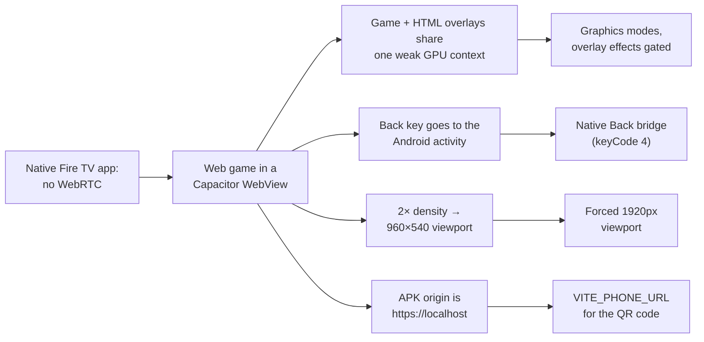

# Kettlebell Knight — Fire TV Friction Log

_As of 2026-10-23 · Oct 10–23, 2026 build, ending in an Amazon hackathon submission_

The biggest Fire TV friction was a forced trade: a native Fire TV app had no WebRTC, so we shipped a web game in an
Android WebView and then spent days clawing back frame rate on a 1 GB stick. Kettlebell Knight is a retro fitness RPG:
the Fire TV runs the game, and a phone's camera counts kettlebell reps and streams them to the TV peer-to-peer.

## Contents

- [Summary](#summary)
- [1. Native vs. WebView: the decision everything else follows](#1-native-vs-webview-the-decision-everything-else-follows)
- [2. The stick is GPU-bound, not CPU-bound](#2-the-stick-is-gpu-bound-not-cpu-bound)
- [3. 1 GB of RAM and WebGL context loss](#3-1-gb-of-ram-and-webgl-context-loss)
- [4. Rendering, art density and graphics modes](#4-rendering-art-density-and-graphics-modes)
- [5. Making a web page behave like a TV app](#5-making-a-web-page-behave-like-a-tv-app)
- [6. Packaging, signing and shipping to the Appstore](#6-packaging-signing-and-shipping-to-the-appstore)
- [7. Pairing the phone to the TV](#7-pairing-the-phone-to-the-tv)
- [8. Audio and tooling](#8-audio-and-tooling)
- [9. Beyond the TV](#9-beyond-the-tv)
- [10. What we'd do from day one next time](#10-what-wed-do-from-day-one-next-time)

## Summary

| # | Friction | Cost | Workaround |
| --- | --- | --- | --- |
| 1 | No WebRTC in a native Fire TV app | Forced the whole architecture | Web app in a Capacitor WebView shell |
| 2 | WebView on a Mali-G31 stick ran battles at 25–29 fps | Laggy core loop | Profiled on device; PERFORMANCE / QUALITY / ULTRA modes with a per-model default |
| 3 | 1 GB RAM, risk of WebGL context loss | Crash risk | 426×240 render, TV-sized atlases, unload per scene |
| 4 | Remote Back key never reached the WebView | Back did nothing, or left battle | Native bridge re-dispatches it as key 4; pause menu |
| 5 | 2× screen density shrank the page to 960×540 | Every overlay rendered twice as big | Force a 1920px viewport in the app |
| 6 | Gradle 8.14 won't run on JDK 25 | Release builds failed | JDK 21 via Homebrew, `keystore.properties` signing |
| 7 | Store review slower than the deadline | Judges couldn't install in time | Live App Testing, sideload via Downloader, `/tv` web demo |
| 8 | Pairing depended on dev-only discovery and a free signalling server | Pairing broke outside the LAN | QR / room code, TURN config, auto-reconnect |

## 1. Native vs. WebView: the decision everything else follows

**Pain.** We wanted a native Fire TV app, but the native SDK had no WebRTC. WebRTC is the phone-to-TV link: without it,
every rep would route through a server, adding lag and cost.

**Workaround.** We kept the game as a web app and wrapped it in an Android WebView with Capacitor
([`capacitor.config.ts`](../capacitor.config.ts), [`android/`](../android)). One codebase now serves the TV, the phone
and a browser demo.

**What it cost.** The WebView's frame rate is capped differently per device and is far slower than native rendering.
On the stick, the game's WebGL, page painting and layer compositing all share one GPU context, so every HTML overlay
steals frame time from the game. Most of the frictions below come from this trade.

## 2. The stick is GPU-bound, not CPU-bound

**Pain.** On Oct 21 the game felt laggy on a real Fire TV Stick (Mali-G31 GPU). Our first checks were headless Chrome
with an 8× CPU throttle: every attack and spell averaged about 2.4 ms a frame and looked fine. That test approximated
the stick's CPU, not its GPU, so it missed the real problem.

**Diagnosis.** We rebuilt the APK with `CAP_WEBVIEW_DEBUG=1` and profiled the WebView from the laptop through
`chrome://inspect`.

| Screen | FPS on the stick | Game canvas only (overlays hidden) |
| --- | --- | --- |
| Title | 60 | — |
| Hub | 30–53 | 60 |
| Battle | 25–29 | 48 |

- During battle the main thread was 71% idle; Pixi and Spine took about 5%.
- The battle page had 47 composited layers, redrawn over the moving game every frame.
- The stick had about 220 MB free and 330 MB already swapped.

**Causes, ranked by measured gain:**

1. The exercise animation in each card animated `background-position`, forcing 5 full card repaints per step.
   Freezing it alone: 25 → 32 fps.
2. Each card carried four card-sized layers (front, back, flash, shine) blended every frame, even while invisible.
3. `backdrop-filter` blur on the hub header, footer and result modals. Removing the footer blur took the hub from 53
   to 60 fps.
4. CRT scanlines and box/text shadows, about 1 fps each. Card, CRT and shadow fixes together reached 35 fps.

**Workaround.** Every GPU-heavy overlay effect moved behind a `:root[data-gfx='performance']` CSS override, and engine
extras behind `isPerformanceMode()`. HUD bars animate with transforms, not width. The rule is now in
[AGENTS.md](../AGENTS.md) so new effects follow it.

## 3. 1 GB of RAM and WebGL context loss

**Pain.** The OS and WebView take most of the 1 GB. Loading too many textures can drop the WebGL context and blank the
game. File size is misleading: a 200 KB PNG at 2048² costs 16 MB once decoded.

**Workarounds.**

- Monsters load per encounter with reference counts; rigs nothing uses are unloaded (`Assets.unload`) when a fight
  ends. Backgrounds and VFX rigs load and unload with their scene.
- Music streams through an HTML5 audio element instead of being decoded into memory. Sound effects are procedural, so
  no audio files ship ([section 8](#8-audio-and-tooling)).
- Battle VRAM measured about 8 MB, and under 1 MB in the hub.

## 4. Rendering, art density and graphics modes

| Pain | Symptom | Workaround |
| --- | --- | --- |
| Full-res canvas too expensive | 1080p is about 20× the pixels of 426×240 on a fill-rate-bound GPU | Render at 426×240 and upscale with CSS `image-rendering: pixelated`; ULTRA raises Pixi's `resolution` (4×) instead of the canvas size, so choreography coordinates never change |
| Monster atlases 10–17× too detailed | Blurry, shimmering monsters from mipmap averaging; full-size art would need about 334 MB VRAM | `scripts/shrink_monsters.py` resizes each atlas to about 1.5 texels per screen pixel (`monsters-tv/`, about 18 MB), drawn without mipmaps |
| Spine VFX rigs too big | All 11 effect rigs load per battle; originals about 133 MB VRAM | `npm run vfx:shrink` makes `vfx-tv/` copies, about 8 MB |
| One quality level can't fit every Fire TV | Mali-G31 sticks lag; a 4K Max could do much more | PERFORMANCE / QUALITY / ULTRA in the title and pause menus ([`src/tv/graphicsMode.ts`](../src/tv/graphicsMode.ts)) |
| Players won't find a settings menu | Low-end owners would just see lag | Default picked from the UA model code: AFTSS, AFTSSS, AFTMM and 2014–2017 models get PERFORMANCE; AFTKA, AFTKM, AFTKRT, AFTR, AFTGAZL and browsers get ULTRA; unknown models need 2+ GB and 4+ cores for QUALITY |
| "Will the Fire TV AI-upscale it?" | No: the WebView already scales to blocky pixels before HDMI, and a TV upscaler can't add detail that was never rendered | Sharpness comes from our own render resolution and art density, not the device |

> [!NOTE]
> The model codes were written from memory of Amazon's specs. Open question: confirm the Cube 3rd gen code
> (`AFTGAZL`) on real hardware.

## 5. Making a web page behave like a TV app

| Pain | Symptom | Workaround |
| --- | --- | --- |
| Back key swallowed by Android | The remote's Back goes to the activity, so the WebView never gets a keydown | `installNativeBackButton()` in [`src/tv/native.ts`](../src/tv/native.ts) re-dispatches it as keyCode 4, which the screens already handle |
| Amazon requires Back to exit from the top screen | An unhandled Back must not close the game mid-transition | Only the title menu and hub call `exitApp()`; any other unhandled Back does nothing |
| Back in battle dumped players into the hub | Mid-workout, one press lost the fight | Back / Esc now opens a pause menu: continue, sound and music, quit battle |
| Two Back key codes | Fire OS sends 4, Vega OS sends 27 (Escape) | `useTVRemote` handles both |
| 2× screen density | `width=device-width` gave a 960×540 CSS viewport, so every px-sized overlay rendered twice as big | `installTvViewport()` forces `width=1920`; MainActivity enables the wide viewport so the WebView zooms to fit |
| No mouse, touch or hover | Any hover-only UI is unreachable | Every TV screen is D-pad navigable: 13 Enter, 37–40 arrows |
| Wrong control hints | The legend showed keyboard keys on a TV | `IS_FIRE_TV` (packaged app, or an `AFT…` UA in Silk) swaps in remote icons; `?controls=remote` previews it in a browser |
| Reviewers and judges have no phone or kettlebell | A companion-device app that "does nothing" gets rejected | Play/Pause (179) or Space performs a demo rep in battle, called out in the testing notes |

## 6. Packaging, signing and shipping to the Appstore

| Pain | Symptom | Workaround |
| --- | --- | --- |
| No Trusted Web Activity | Fire TV has no Chrome, so a TWA isn't an option | Capacitor Android shell bundling `dist/` (`npm run tv:sync`), or loading `CAP_SERVER_URL` |
| Toolchain mismatch | Android Studio's bundled Java 25 can't run Gradle 8.14 | Install JDK 21 with Homebrew and point `JAVA_HOME` at it for `./gradlew assembleRelease` |
| SDK path not found | First Gradle build failed in the shell | Pass `ANDROID_HOME=~/Library/Android/sdk`, or set `sdk.dir` in `android/local.properties` |
| Signing only through the Android Studio UI | No one-command release build | `signingConfigs.release` reads a gitignored `android/keystore.properties`; key backed up outside git |
| QR code pointed nowhere in the APK | The app's origin is `https://localhost`, so a QR built from `window.location.origin` was useless | `VITE_PHONE_URL` (in `.env` for every mode) points the QR at the GitHub Pages phone app |
| Bloated APK | 112.7 MB, including 40.6 MB of full-size monster PNGs the TV never loads | `tv:sync` already prunes the source VFX and `.wav` stems; pruning `spine/monsters/*.png` takes it to about 72 MB |
| Vega OS | Amazon's newest sticks run Vega OS, which doesn't run Android APKs | Ship to Fire OS models only; check device targeting in the console |
| Reviewer can't play | Companion-device apps get rejected as "doesn't function" | Testing notes explain the phone controller, QR flow and the Play/Pause demo swing |
| Review slower than the Oct 23 hackathon deadline | App submitted Oct 21, still in review | Three parallel routes, below |
| Paid app vs. a free web build | The full game was playable at the Pages `/tv` URL | Keep `/tv` up through judging, then remove it; turn DRM on for the paid APK |

**Getting the game to judges before review finished:**

1. **Live App Testing**: add judges' Amazon emails as testers; installs from the real Appstore with a much lighter
   check.
2. **Sideload**: judges install the Downloader app and type a direct link. GitHub Pages rejects files over 100 MB and
   Downloader can't open Google Drive links, so use a GitHub release or a Dropbox `?dl=1` link with the trimmed APK.
3. **Web demo**: <https://longwashere.github.io/kettlebell-knight/tv/> runs the whole game in a desktop browser, and a
   phone pairs to it.

Plus a 1–2 minute video of phone and TV working together, in case the live demo fails.

## 7. Pairing the phone to the TV

| Pain | Symptom | Workaround |
| --- | --- | --- |
| "Wi-Fi scan" was a dev-server trick | `/api/discovery/*` is Vite middleware, so auto-pairing never worked in the APK or on Pages | Gate it behind `LAN_DISCOVERY` (dev only); production pairs by QR code or room code |
| Re-scanning the QR every session | Friction on every workout | The TV keeps its room code across launches; the phone remembers its last room (`lastPairedRoom`), so the home-screen PWA reconnects |
| Free PeerJS cloud has no uptime guarantee | If it's down, no new pairings start | Accepted for the demo; `VITE_PEER_HOST` lets us self-host (`npx peerjs`) later. Gameplay is peer-to-peer, so the server only carries pairing |
| TV silently vanished after a signalling drop | Phones got `peer-unavailable` until the TV app restarted | `NetworkManager` calls `peer.reconnect()` on `disconnected` with 1–30 s backoff and keeps the same room code. Tested by `kill -9` on a local PeerServer |
| STUN only, no TURN | Phones on cellular or strict venue Wi-Fi may never connect | `VITE_TURN_*` / `VITE_ICE_SERVERS_URL` config, all built through `peerOptions()`; for demos, bring a hotspot |
| Camera needs HTTPS | A phone on the LAN dev server over plain HTTP can't open the camera | Phone app hosted on GitHub Pages (HTTPS) as an installable PWA |

## 8. Audio and tooling

| Pain | Symptom | Workaround |
| --- | --- | --- |
| Sound files cost memory | Howler decodes each sound fully; a 3-minute stereo track is about 60 MB | No audio files ship: about 75 procedural recipes render small mono 22 kHz buffers on first play; music streams through one HTML5 audio element |
| Too many voices on a weak device | Stacked impacts in big spells | `AudioManager` caps voices at 12, softens or drops repeats within 45 ms, one compressor on the bus |
| Laptop tests lied about the stick | 8× CPU throttling in headless Chrome approximates the CPU, not the GPU | Measure on the device: `CAP_WEBVIEW_DEBUG=1 npm run tv:sync` + `chrome://inspect`; ship without the flag |
| Debuggable build left on the stick | Easy to ship by accident | A normal `npm run tv:sync` rebuilds without WebView debugging |
| Slow manual check loop | Every visual change needed a play-through on the TV | `npm run shot` drives `/tv` headlessly through `window.__kk` and saves screenshots, state and console errors; `--cpu <rate>` throttles |
| Testing every spell by hand | 41+ spells to review | Console scripts ([`scripts/console-spell-test.js`](../scripts/console-spell-test.js), [`scripts/spell-tour.js`](../scripts/spell-tour.js)) cast them back to back for review and recording |
| Chapter art appeared late | Picture fully up 1.95 s after a page turn | Curtain cut to 0.3 s down, 0.6 s up (`CURTAIN_COVER_MS = 300`) |

## 9. Beyond the TV

| Pain | Workaround |
| --- | --- |
| Camera false positives from partial bodies in frame | A visibility gate that needs the body down to the knees (ankles were too strict) |
| Swings, cleans and snatches look alike from the front | A per-exercise rep state machine (`KinematicTracker`, 13 exercises) plus a `/test` motion lab for calibration |
| Hosted asset URLs broke under the Pages base path | Build every URL from `ASSET_ROOT` or `import.meta.env.BASE_URL`, never a bare `/assets/...` |
| Screen sleeping mid-workout | Wake Lock requested only inside the "Begin Workout" click, as browsers require |

## 10. What we'd do from day one next time

1. **Prove the platform constraint first.** Check WebRTC and WebView performance on the cheapest target stick in week
   one, before building content.
2. **Profile on the device, not a throttled laptop.** Wire up `chrome://inspect` on a debuggable APK early; the
   stick's bottleneck was the GPU, which no CPU throttle shows.
3. **Treat HTML overlays as GPU cost.** On a Fire TV WebView, blur, blend modes, animated backgrounds and stacked
   translucent layers compete directly with the game canvas.
4. **Ship a graphics setting with a per-model default.** One quality level can't fit both a Mali-G31 stick and a
   4K Max.
5. **Size art for the screen.** Export atlases near the on-screen density and budget VRAM, not file size.
6. **Start store review early.** Submit a Live App Testing build days ahead of any deadline, with testing notes and a
   no-phone demo mode.
7. **Don't depend on dev-only infrastructure.** LAN discovery, the free signalling server and STUN-only ICE all worked
   at home and failed elsewhere.
