# Monster rigs

Generated by `npm run rigs` — do not edit. Lengths are 60 fps frames (the move Timeline unit). A rig with
`faces: left` is authored facing the knight; others are flipped by the engine. `height` is what moves use
for `crown(h, up)` / `h.height`. Animations a rig lacks are silently ignored by `h.anim()` (and flagged by
`npm run shot -- movecheck`). Pose 0-frame `pose_*` animations with `h.anim(name, true)` and end with `h.idle()`.

## green_slime — GREEN SLIME (DUNGEON OOZE)

- sprite `SLIME` · lvl 5 · 140 HP · rig `public/assets/spine/monsters/greenSlime/TuXi01.json`
- scale 0.12 · height 30px · faces right (flipped)
- roles: idle=`Idle` · attack=`Atk1` · heavyAttack=`Skl1` · hit=`Hit` · death=`Death`

| animation | frames | events | used by moves |
|---|---:|---|:-:|
| `1` | 28 |  |  |
| `2` | 28 |  |  |
| `Atk1` | 40 |  | ✓ |
| `Death` | 100 |  |  |
| `Hit` | 20 |  |  |
| `Idle` | 60 |  |  |
| `Move` | 40 |  | ✓ |
| `Skl1` | 100 |  | ✓ |

| move | intent | dmg / block | timer | choreography |
|---|---|---:|---:|---|
| Slime Slap | ATTACK | 12 | 13.5s | `slime_slap` |
| Acid Spit | ATTACK | 9 | 10.5s | `slime_acid_spit` |
| Ooze Slam | HEAVY_ATTACK | 21 | 18s | `slime_ooze_slam` |
| Corrosive Engulf | HEAVY_ATTACK | 16 | 16.5s | `slime_engulf` |

## boar — RAZORBACK BOAR (TUSKED CHARGER)

- sprite `BOAR` · lvl 6 · 170 HP · rig `public/assets/spine/monsters/boar/monster_3010101.json`
- scale 0.38 · height 35px · faces left
- roles: idle=`idle` · attack=`skill` · heavyAttack=`skill2` · hit=`hit` · death=`die`

| animation | frames | events | used by moves |
|---|---:|---|:-:|
| `bak` | 60 |  | ✓ |
| `die` | 0 |  |  |
| `hit` | 30 |  |  |
| `idle` | 80 |  |  |
| `move` | 80 |  | ✓ |
| `skill` | 54 |  | ✓ |
| `skill2` | 240 |  | ✓ |

| move | intent | dmg / block | timer | choreography |
|---|---|---:|---:|---|
| Gore Charge | HEAVY_ATTACK | 24 | 15.5s | `boar_gore_charge` |
| Tusk Slash | ATTACK | 14 | 11s | `boar_tusk_slash` |
| Earthsplitter | ATTACK | 16 | 13s | `boar_earthsplitter` |
| Quill Volley | ATTACK | 10 | 10s | `boar_quill_volley` |
| Iron Bristles | DEFEND | 20 | 12.5s | `boar_iron_bristles` |

## wolf — SHADOW WOLF (NOCTURNAL PREDATOR)

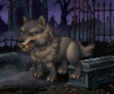

- sprite `WOLF` · lvl 7 · 160 HP · rig `public/assets/spine/monsters/wolf/Unit_Spine_Wolf1.json`
- scale 0.13 · height 40px · faces left
- roles: idle=`stand` · appear=`posture` · attack=`attack` · heavyAttack=`skill1` · hit=`hurt` · death=`death`

| animation | frames | events | used by moves |
|---|---:|---|:-:|
| `attack` | 50 |  | ✓ |
| `death` | 50 |  |  |
| `hurt` | 26 |  |  |
| `posture` | 40 |  | ✓ |
| `run` | 32 |  | ✓ |
| `skill1` | 56 |  | ✓ |
| `stand` | 60 |  |  |

| move | intent | dmg / block | timer | choreography |
|---|---|---:|---:|---|
| Throat Bite | HEAVY_ATTACK | 22 | 14.5s | `wolf_throat_bite` |
| Shadow Pounce | ATTACK | 12 | 9.5s | `wolf_shadow_pounce` |
| Predator Rake | ATTACK | 15 | 11.5s | `wolf_predator_rake` |
| Phantom Pack | HEAVY_ATTACK | 19 | 18s | `wolf_phantom_pack` |

## treemon — TREEMON (ROOTBOUND GUARDIAN)

- sprite `TREEMON` · lvl 8 · 210 HP · rig `public/assets/spine/monsters/Treemon/XiaoShuRen.json`
- scale 0.14 · height 55px · faces right (flipped)
- roles: idle=`Idle` · appear=`Appear` · attack=`Atk1` · heavyAttack=`Atk1` · defend=`Stun` · hit=`Hit` · death=`Death`

| animation | frames | events | used by moves |
|---|---:|---|:-:|
| `Appear` | 50 | FXEvent_1@f0 Sound_2@f2 | ✓ |
| `Atk1` | 50 | Sound_1@f24 | ✓ |
| `Controlled` | 60 |  | ✓ |
| `Death` | 60 |  |  |
| `Hit` | 20 |  |  |
| `Idle` | 60 |  |  |
| `Move` | 24 |  | ✓ |
| `Move2` | 40 |  |  |
| `Stun` | 60 |  | ✓ |

| move | intent | dmg / block | timer | choreography |
|---|---|---:|---:|---|
| Branch Whip | ATTACK | 16 | 12.5s | `tree_branch_whip` |
| Root Stomp | HEAVY_ATTACK | 28 | 17.5s | `tree_root_stomp` |
| Burrow Ambush | HEAVY_ATTACK | 22 | 16s | `tree_burrow_ambush` |
| Spore Burst | ATTACK | 12 | 11.5s | `tree_spore_burst` |
| Bark Skin | DEFEND | 25 | 12s | `tree_bark_skin` |

## demon_monk — DEMON MONK (CORRUPTED ACOLYTE)

- sprite `DEMON_MONK` · lvl 10 · 220 HP · rig `public/assets/spine/monsters/demonMonk/spine_monster_201150001.json`
- scale 0.26 · height 62px · faces left
- roles: idle=`idle` · attack=`attack` · heavyAttack=`bothcast` · defend=`selfcast` · hit=`hit` · death=`hit`

| animation | frames | events | used by moves |
|---|---:|---|:-:|
| `attack` | 60 | audio@f10 fx@f28 | ✓ |
| `bothcast` | 60 | audio@f2 fx@f20 selffx@f20 | ✓ |
| `cast` | 60 | audio@f2 fx@f20 | ✓ |
| `hit` | 30 |  |  |
| `idle` | 120 |  |  |
| `selfcast` | 60 | audio@f2 selffx@f20 | ✓ |

| move | intent | dmg / block | timer | choreography |
|---|---|---:|---:|---|
| Abyssal Edict | HEAVY_ATTACK | 29 | 16.5s | `monk_abyssal_edict` |
| Cursed Palm | ATTACK | 18 | 11.5s | `monk_cursed_palm` |
| Hellfire Orb | ATTACK | 15 | 12.5s | `monk_hellfire_orb` |
| Chains of Penance | ATTACK | 13 | 11s | `monk_chains_of_penance` |
| Forbidden Ward | DEFEND | 28 | 12s | `monk_forbidden_ward` |

## hellhound — HELLHOUND (TWO-HEADED HOUND)

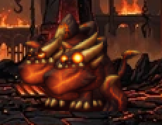

- sprite `HELLHOUND` · lvl 12 · 260 HP · rig `public/assets/spine/monsters/2headedDog/DiYuShuangTouQuan.json`
- scale 0.16 · height 45px · faces right (flipped)
- roles: idle=`Idle` · appear=`Appear_03` · attack=`Attack` · heavyAttack=`Skill` · hit=`Hit` · death=`Death`

| animation | frames | events | used by moves |
|---|---:|---|:-:|
| `Appear_01` | 20 |  |  |
| `Appear_02` | 18 |  |  |
| `Appear_03` | 56 |  | ✓ |
| `Attack` | 68 |  | ✓ |
| `Death` | 84 |  |  |
| `Hit` | 40 |  |  |
| `Idle` | 120 |  | ✓ |
| `Raft_Attack` | 42 |  | ✓ |
| `Run` | 36 |  | ✓ |
| `Skill` | 114 |  | ✓ |

| move | intent | dmg / block | timer | choreography |
|---|---|---:|---:|---|
| Twin Maul | HEAVY_ATTACK | 27 | 15s | `hound_twin_maul` |
| Savage Frenzy | ATTACK | 14 | 9.5s | `hound_savage_frenzy` |
| Hellfire Breath | ATTACK | 19 | 13.5s | `hound_hellfire_breath` |
| Magma Rampage | HEAVY_ATTACK | 24 | 17s | `hound_magma_rampage` |
| Brimstone Rain | ATTACK | 17 | 14.5s | `hound_brimstone_rain` |

## bat — CAVE BAT (NIGHT STALKER)

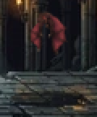

- sprite `BAT` · lvl 3 · 100 HP · rig `public/assets/spine/monsters/bat/CaveBat.json`
- scale 0.038 · height 40px · faces left · hovers 15px · skin `normal`
- roles: idle=`idle` · attack=`attack` · heavyAttack=`attack` · hit=`hurt` · death=`death`

| animation | frames | events | used by moves |
|---|---:|---|:-:|
| `attack` | 94 | UnitActionCompleted@f38 | ✓ |
| `death` | 74 |  |  |
| `defend` | 52 |  | ✓ |
| `evade` | 80 |  |  |
| `hurt` | 56 |  |  |
| `idle` | 40 |  |  |
| `pose_attack` | 0 |  |  |
| `pose_cast_spell` | 0 |  |  |
| `pose_death` | 0 |  |  |
| `pose_defend` | 0 |  |  |
| `pose_hurt` | 0 |  |  |
| `unused_attack1` | 40 |  | ✓ |
| `unused_attack2` | 80 |  | ✓ |
| `unused_attack3` | 68 |  | ✓ |

| move | intent | dmg / block | timer | choreography |
|---|---|---:|---:|---|
| Wing Buffet | ATTACK | 8 | 8.5s | `bat_wing_buffet` |
| Screech Dive | HEAVY_ATTACK | 14 | 12s | `bat_screech_dive` |
| Blood Drain | ATTACK | 10 | 10s | `bat_blood_drain` |
| Echo Swarm | ATTACK | 13 | 12.5s | `bat_echo_swarm` |

## goblin — GOBLIN SCOUT (WOODLAND THIEF)

- sprite `GOBLIN` · lvl 4 · 120 HP · rig `public/assets/spine/monsters/goblin/goblin.json`
- scale 0.039 · height 50px · faces right (flipped)
- roles: idle=`Idle` · attack=`Attack` · heavyAttack=`Attack` · hit=`Hit` · death=`Dead`

| animation | frames | events | used by moves |
|---|---:|---|:-:|
| `Attack` | 38 |  | ✓ |
| `Dead` | 38 |  |  |
| `Hit` | 24 |  |  |
| `Idle` | 60 |  | ✓ |
| `Run` | 36 |  | ✓ |

| move | intent | dmg / block | timer | choreography |
|---|---|---:|---:|---|
| Rusty Shank | ATTACK | 9 | 9s | `goblin_rusty_shank` |
| Sneak Pounce | HEAVY_ATTACK | 16 | 13s | `goblin_sneak_pounce` |
| Sling Stone | ATTACK | 11 | 10.5s | `goblin_sling_stone` |
| Firebomb Toss | ATTACK | 14 | 12.5s | `goblin_firebomb` |

## mushroom — SPORE MUSHROOM (TOXIC FUNGUS)

- sprite `MUSHROOM` · lvl 4 · 130 HP · rig `public/assets/spine/monsters/mushroom-creature/M_Mushroom.json`
- scale 0.256 · height 42px · faces right (flipped)
- roles: idle=`idle` · attack=`action_1` · heavyAttack=`action_1` · hit=`idle` · death=`idle`

| animation | frames | events | used by moves |
|---|---:|---|:-:|
| `action_1` | 60 |  | ✓ |
| `idle` | 60 |  |  |
| `walk` | 40 |  | ✓ |

| move | intent | dmg / block | timer | choreography |
|---|---|---:|---:|---|
| Spore Cloud | ATTACK | 10 | 11s | `shroom_spore_cloud` |
| Toxic Burst | HEAVY_ATTACK | 18 | 14s | `shroom_toxic_burst` |
| Fungal Spores | DEFEND | 18 | 11.5s | `shroom_fungal_guard` |
| Mycelium Snare | ATTACK | 10 | 12.5s | `shroom_mycelium_snare` |

## ghost — RESTLESS GHOST (HAUNTING SPECTER)

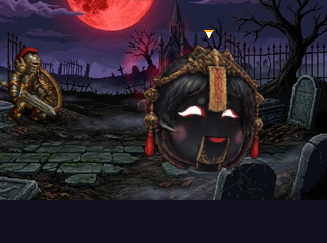

- sprite `GHOST` · lvl 5 · 130 HP · rig `public/assets/spine/monsters/ghost/ghost.json`
- scale 0.455 · height 45px · faces right (flipped)
- roles: idle=`idle` · attack=`attack_middle` · heavyAttack=`attack_end` · hit=`get_hit` · death=`get_hit`

| animation | frames | events | used by moves |
|---|---:|---|:-:|
| `attack_end` | 24 | SkillComplete@f22 | ✓ |
| `attack_middle` | 32 |  | ✓ |
| `attack_start` | 40 | Fire@f40 | ✓ |
| `get_hit` | 10 |  |  |
| `idle` | 80 |  |  |

| move | intent | dmg / block | timer | choreography |
|---|---|---:|---:|---|
| Chilling Grasp | ATTACK | 11 | 10s | `ghost_chilling_grasp` |
| Banshee Wail | HEAVY_ATTACK | 20 | 14.5s | `ghost_banshee_wail` |
| Phantasmal Bolt | ATTACK | 13 | 11.5s | `ghost_phantasmal_bolt` |
| Possession | HEAVY_ATTACK | 17 | 14s | `ghost_possession` |

## giant_spider — BROOD SPIDER (WEB WEAVER)

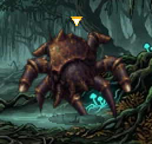

- sprite `GIANT_SPIDER` · lvl 5 · 150 HP · rig `public/assets/spine/monsters/giant-spider/spider_anim_85.json`
- scale 0.791 · height 45px · faces right (flipped)
- roles: idle=`spider_anim_85_idle` · attack=`spider_anim_85_idle` · heavyAttack=`spider_anim_85_idle` · hit=`spider_anim_85_idle` · death=`spider_anim_85_idle`

| animation | frames | events | used by moves |
|---|---:|---|:-:|
| `spider_anim_85_idle` | 80 |  |  |
| `spider_anim_85_transp` | 0 |  |  |

| move | intent | dmg / block | timer | choreography |
|---|---|---:|---:|---|
| Venom Fangs | ATTACK | 12 | 10s | `spider_venom_fangs` |
| Silk Cocoon | HEAVY_ATTACK | 21 | 15s | `spider_silk_cocoon` |
| Skittering Lunge | ATTACK | 14 | 11s | `spider_skitter_lunge` |
| Brood Swarm | ATTACK | 16 | 12.5s | `spider_brood_swarm` |

## skeleton_archer — SKELETON ARCHER (CRYPT MARKSMAN)

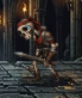

- sprite `SKELETON_ARCHER` · lvl 6 · 140 HP · rig `public/assets/spine/monsters/skeleton-archer/skeleton.json`
- scale 0.099 · height 55px · faces right (flipped)
- roles: idle=`Idle` · attack=`Attack1` · heavyAttack=`Attack1` · hit=`Hit` · death=`Dead`

| animation | frames | events | used by moves |
|---|---:|---|:-:|
| `Attack1` | 44 |  | ✓ |
| `Dead` | 70 |  |  |
| `Hit` | 24 |  |  |
| `Idle` | 64 |  |  |
| `Run` | 32 |  |  |

| move | intent | dmg / block | timer | choreography |
|---|---|---:|---:|---|
| Bone Arrow | ATTACK | 13 | 9.5s | `archer_bone_arrow` |
| Piercing Volley | HEAVY_ATTACK | 22 | 14s | `archer_piercing_volley` |
| Poison Shaft | ATTACK | 15 | 11s | `archer_poison_shaft` |
| Soul Arrow | HEAVY_ATTACK | 20 | 14s | `archer_soul_arrow` |

## skeleton_warrior — SKELETON WARRIOR (UNDYING FOOTMAN)

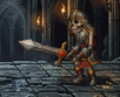

- sprite `SKELETON_WARRIOR` · lvl 6 · 160 HP · rig `public/assets/spine/monsters/skeleton-warrior/skeleton_worrior.json`
- scale 0.047 · height 58px · faces right (flipped)
- roles: idle=`Idle` · attack=`Attack` · heavyAttack=`Attack` · hit=`Hit` · death=`Dead`

| animation | frames | events | used by moves |
|---|---:|---|:-:|
| `Attack` | 46 |  | ✓ |
| `Dead` | 86 |  | ✓ |
| `Hit` | 30 |  | ✓ |
| `Idle` | 60 |  |  |
| `Run` | 36 |  | ✓ |

| move | intent | dmg / block | timer | choreography |
|---|---|---:|---:|---|
| Scimitar Slash | ATTACK | 14 | 10.5s | `skwar_scimitar_slash` |
| Shield Bash | HEAVY_ATTACK | 23 | 14.5s | `skwar_shield_bash` |
| Bone Phalanx | DEFEND | 22 | 11.5s | `skwar_bone_phalanx` |
| Bone Ambush | ATTACK | 13 | 12.5s | `skwar_bone_ambush` |

## harpy — CLIFF HARPY (WINGED SCREAMER)

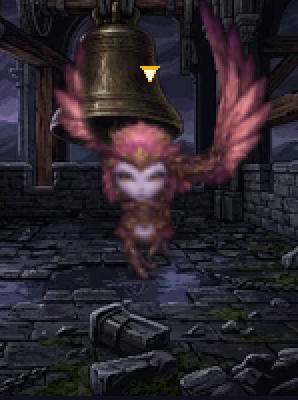

- sprite `HARPY` · lvl 7 · 150 HP · rig `public/assets/spine/monsters/harpy/Harpy.json`
- scale 0.8 · height 55px · faces left
- roles: idle=`Move` · attack=`Attack_01` · heavyAttack=`Attack_01` · hit=`Move` · death=`Die`

| animation | frames | events | used by moves |
|---|---:|---|:-:|
| `Attack_01` | 56 |  | ✓ |
| `Die` | 52 |  |  |
| `Move` | 80 |  | ✓ |

| move | intent | dmg / block | timer | choreography |
|---|---|---:|---:|---|
| Talon Rake | ATTACK | 14 | 9.5s | `harpy_talon_rake` |
| Cyclone Screech | HEAVY_ATTACK | 24 | 14s | `harpy_cyclone` |
| Aerial Dive | ATTACK | 16 | 11.5s | `harpy_aerial_dive` |
| Feather Storm | ATTACK | 19 | 12.5s | `harpy_feather_storm` |

## lizardman — LIZARDMAN SLAYER (SWAMP SKIRMISHER)

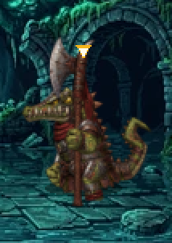

- sprite `LIZARDMAN` · lvl 8 · 180 HP · rig `public/assets/spine/monsters/lizardman/lizardman.json`
- scale 0.089 · height 58px · faces right (flipped)
- roles: idle=`Idle` · attack=`Attack01` · heavyAttack=`Attack01` · hit=`Hit` · death=`Dead`

| animation | frames | events | used by moves |
|---|---:|---|:-:|
| `Attack01` | 44 |  | ✓ |
| `Dead` | 64 |  |  |
| `Hit` | 24 |  | ✓ |
| `Idle` | 64 |  |  |
| `Run` | 32 |  | ✓ |
| `animation` | 140 |  | ✓ |

| move | intent | dmg / block | timer | choreography |
|---|---|---:|---:|---|
| Trident Thrust | ATTACK | 15 | 10.5s | `lizard_trident_thrust` |
| Tail Whip | HEAVY_ATTACK | 25 | 14.5s | `lizard_tail_whip` |
| Reptile Scales | DEFEND | 24 | 12s | `lizard_scale_guard` |
| Swamp Ambush | ATTACK | 14 | 12.5s | `lizard_swamp_ambush` |

## orc — ORC BERSERKER (SAVAGE WARRIOR)

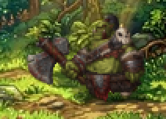

- sprite `ORC` · lvl 8 · 200 HP · rig `public/assets/spine/monsters/orc/orc_warrior.json`
- scale 0.048 · height 60px · faces right (flipped)
- roles: idle=`Idle` · attack=`Attack` · heavyAttack=`Attack` · hit=`Hit` · death=`Dead`

| animation | frames | events | used by moves |
|---|---:|---|:-:|
| `Attack` | 66 |  | ✓ |
| `Dead` | 48 |  |  |
| `Hit` | 32 |  |  |
| `Idle` | 80 |  | ✓ |
| `Run` | 60 |  | ✓ |

| move | intent | dmg / block | timer | choreography |
|---|---|---:|---:|---|
| Battleaxe Chop | ATTACK | 17 | 11s | `orc_axe_chop` |
| Blood Frenzy | HEAVY_ATTACK | 28 | 15.5s | `orc_blood_frenzy` |
| War Cry Slam | ATTACK | 19 | 12.5s | `orc_war_cry_slam` |
| Axe Throw | ATTACK | 21 | 12.5s | `orc_axe_throw` |

## dark_mage — CORRUPTED MAGE (SHADOW CASTER)

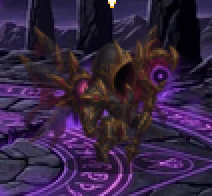

- sprite `DARK_MAGE` · lvl 9 · 170 HP · rig `public/assets/spine/monsters/dark-mage/Unit_Spine_BirdMageSpe1Skin1.json`
- scale 0.09 · height 52px · faces right (flipped)
- roles: idle=`stand` · attack=`attack` · heavyAttack=`skill1` · hit=`hurt` · death=`death`

| animation | frames | events | used by moves |
|---|---:|---|:-:|
| `attack` | 60 | attack@f24 | ✓ |
| `death` | 48 |  |  |
| `hurt` | 24 |  |  |
| `posture` | 60 |  |  |
| `run` | 40 |  |  |
| `skill1` | 66 | attack@f20 | ✓ |
| `skill2` | 110 | attack@f50 | ✓ |
| `skill3` | 110 | attack@f52 | ✓ |
| `stand` | 60 |  |  |

| move | intent | dmg / block | timer | choreography |
|---|---|---:|---:|---|
| Shadow Bolt | ATTACK | 16 | 11s | `mage_shadow_bolt` |
| Doom Curse | HEAVY_ATTACK | 27 | 15s | `mage_doom_curse` |
| Nether Ward | DEFEND | 26 | 12s | `mage_nether_ward` |
| Raven Storm | ATTACK | 14 | 12.5s | `mage_raven_storm` |

## water_elemental — WATER ELEMENTAL (TIDAL SURGE)

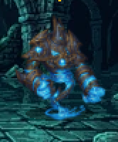

- sprite `WATER_ELEMENTAL` · lvl 9 · 210 HP · rig `public/assets/spine/monsters/water-elemental/water_elemental.json`
- scale 0.101 · height 60px · faces left
- roles: idle=`Idle` · attack=`Attack01` · heavyAttack=`Attack01` · hit=`Hit` · death=`Dead`

| animation | frames | events | used by moves |
|---|---:|---|:-:|
| `Attack01` | 64 |  | ✓ |
| `Dead` | 60 |  |  |
| `Hit` | 24 |  |  |
| `Idle` | 120 |  |  |
| `Run` | 40 |  |  |
| `animation` | 120 |  | ✓ |

| move | intent | dmg / block | timer | choreography |
|---|---|---:|---:|---|
| Tidal Strike | ATTACK | 16 | 11.5s | `water_tidal_strike` |
| Geyser Eruption | HEAVY_ATTACK | 28 | 15.5s | `water_geyser` |
| Aqua Barrier | DEFEND | 28 | 12.5s | `water_aqua_barrier` |
| Bubble Prison | ATTACK | 14 | 12.5s | `water_bubble_prison` |

## nightmare_stag — NIGHTMARE STAG (FOREST PHANTOM)

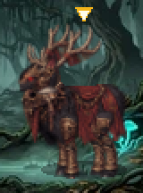

- sprite `NIGHTMARE_STAG` · lvl 9 · 190 HP · rig `public/assets/spine/monsters/nightmare-stag/AnimalAnim5.json`
- scale 0.293 · height 60px · faces right (flipped) · skins default, body/normal, eye/close, eye/happy, eye/ill, eye/normal
- roles: idle=`body/idle` · attack=`body/action1` · heavyAttack=`body/action2` · hit=`body/idle` · death=`body/idle`

| animation | frames | events | used by moves |
|---|---:|---|:-:|
| `body/action1` | 104 |  | ✓ |
| `body/action2` | 80 |  | ✓ |
| `body/idle` | 220 |  |  |
| `mouth/eat` | 94 |  |  |
| `mouth/open` | 0 |  |  |

| move | intent | dmg / block | timer | choreography |
|---|---|---:|---:|---|
| Spectral Antlers | ATTACK | 16 | 11s | `stag_spectral_antlers` |
| Ethereal Trample | HEAVY_ATTACK | 27 | 15s | `stag_ethereal_trample` |
| Mist Veil | ATTACK | 18 | 12.5s | `stag_mist_veil` |
| Moonlit Bellow | ATTACK | 20 | 12.5s | `stag_moon_bellow` |

## golem — STONE GOLEM (EARTHEN SENTINEL)

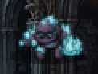

- sprite `GOLEM` · lvl 10 · 240 HP · rig `public/assets/spine/monsters/golem/StoneGolem.json`
- scale 0.215 · height 60px · faces right (flipped) · skin `i`
- roles: idle=`idle` · attack=`atk` · heavyAttack=`atk` · hit=`idle` · death=`die`

| animation | frames | events | used by moves |
|---|---:|---|:-:|
| `atk` | 65 | shoot@f45 | ✓ |
| `die` | 50 |  |  |
| `idle` | 60 |  |  |
| `run` | 50 |  | ✓ |
| `summon` | 95 | shoot@f20 | ✓ |

| move | intent | dmg / block | timer | choreography |
|---|---|---:|---:|---|
| Stone Hammer | ATTACK | 18 | 12.5s | `golem_stone_hammer` |
| Earthquake Stomp | HEAVY_ATTACK | 30 | 16.5s | `golem_earthquake` |
| Granite Skin | DEFEND | 32 | 13s | `golem_granite_skin` |
| Crystal Barrage | ATTACK | 14 | 12.5s | `golem_crystal_barrage` |

## vault_guardian — VAULT GUARDIAN (ARMORED AUTOMATON)

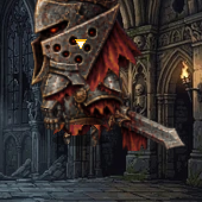

- sprite `VAULT_GUARDIAN` · lvl 10 · 250 HP · rig `public/assets/spine/monsters/vault-guardian/BS_small_armormonster_Ani.json`
- scale 0.114 · height 62px · faces right (flipped)
- roles: idle=`idle` · attack=`attack` · heavyAttack=`attack` · hit=`1Hit` · death=`1Hit`

| animation | frames | events | used by moves |
|---|---:|---|:-:|
| `1Hit` | 0 |  |  |
| `attack` | 30 | gongji@f14 | ✓ |
| `idle` | 100 |  | ✓ |
| `move` | 40 |  | ✓ |

| move | intent | dmg / block | timer | choreography |
|---|---|---:|---:|---|
| Iron Cleaver | ATTACK | 18 | 11.5s | `vault_iron_cleaver` |
| Core Discharge | HEAVY_ATTACK | 31 | 16s | `vault_core_discharge` |
| Aegis Lockdown | DEFEND | 35 | 13s | `vault_aegis_lockdown` |
| Piston Slam | ATTACK | 15 | 12.5s | `vault_piston_slam` |

## wraith — DUNGEON WRAITH (CHILLING PHANTASM)

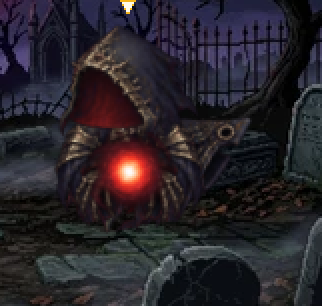

- sprite `WRAITH` · lvl 10 · 190 HP · rig `public/assets/spine/monsters/wraith/specter.json`
- scale 0.37 · height 50px · faces right (flipped)
- roles: idle=`idle` · attack=`attack` · heavyAttack=`attack` · hit=`idle` · death=`idle`

| animation | frames | events | used by moves |
|---|---:|---|:-:|
| `attack` | 30 |  | ✓ |
| `idle` | 80 |  |  |

| move | intent | dmg / block | timer | choreography |
|---|---|---:|---:|---|
| Soul Siphon | ATTACK | 17 | 10.5s | `wraith_soul_siphon` |
| Shadow Vortex | HEAVY_ATTACK | 29 | 15s | `wraith_shadow_vortex` |
| Death Chill | ATTACK | 20 | 12s | `wraith_death_chill` |
| Reaper's Scythe | HEAVY_ATTACK | 25 | 14s | `wraith_reaper_scythe` |

## gargoyle — STONE GARGOYLE (RAMPART DEFENDER)

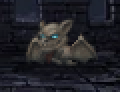

- sprite `GARGOYLE` · lvl 11 · 230 HP · rig `public/assets/spine/monsters/gargoyle/GargoyleEnemy.json`
- scale 0.016 · height 65px · faces right (flipped)
- roles: idle=`move` · attack=`attack` · heavyAttack=`attack` · hit=`damage` · death=`death`

| animation | frames | events | used by moves |
|---|---:|---|:-:|
| `attack` | 40 |  | ✓ |
| `damage` | 40 |  |  |
| `death` | 40 |  |  |
| `gotosleep` | 60 |  |  |
| `immobilization` | 132 |  | ✓ |
| `move` | 40 |  | ✓ |
| `push` | 40 |  | ✓ |
| `stun` | 60 |  | ✓ |
| `wakeup` | 60 |  | ✓ |

| move | intent | dmg / block | timer | choreography |
|---|---|---:|---:|---|
| Gargoyle Talon | ATTACK | 19 | 11s | `garg_talon` |
| Rampart Dive | HEAVY_ATTACK | 32 | 16s | `garg_rampart_dive` |
| Stone Form | DEFEND | 30 | 12.5s | `garg_stone_form` |
| Rubble Hurl | ATTACK | 16 | 12.5s | `garg_rubble_hurl` |

## dark_knight — DARK KNIGHT (FALLEN CHAMPION)

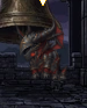

- sprite `DARK_KNIGHT` · lvl 11 · 260 HP · rig `public/assets/spine/monsters/dark-knight/Darkknight_monster05.json`
- scale 0.09 · height 65px · faces right (flipped)
- roles: idle=`Idle` · attack=`Attack01` · heavyAttack=`Attack01` · hit=`Hit` · death=`Dead`

| animation | frames | events | used by moves |
|---|---:|---|:-:|
| `Attack01` | 56 |  | ✓ |
| `Dead` | 70 |  |  |
| `Hit` | 20 |  | ✓ |
| `Idle` | 40 |  | ✓ |
| `Run` | 28 |  | ✓ |

| move | intent | dmg / block | timer | choreography |
|---|---|---:|---:|---|
| Black Blade | ATTACK | 20 | 11.5s | `dk_black_blade` |
| Abyssal Cleave | HEAVY_ATTACK | 34 | 16.5s | `dk_abyssal_cleave` |
| Dread Bastion | DEFEND | 30 | 12.5s | `dk_dread_bastion` |
| Shadow Step | HEAVY_ATTACK | 19 | 14s | `dk_shadow_step` |

## minotaur — LABYRINTH MINOTAUR (HORNED CRUSHER)

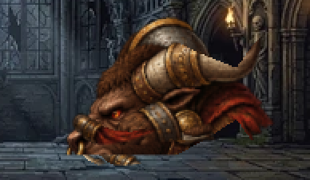

- sprite `MINOTAUR` · lvl 12 · 270 HP · rig `public/assets/spine/monsters/minotaur/BlackBullhead.json`
- scale 0.42 · height 65px · faces right (flipped)
- roles: idle=`idle` · attack=`active1` · heavyAttack=`quickly` · hit=`idle` · death=`idle`

| animation | frames | events | used by moves |
|---|---:|---|:-:|
| `Lockidle` | 400 |  |  |
| `active1` | 60 |  | ✓ |
| `eat` | 144 |  | ✓ |
| `eat2` | 144 |  |  |
| `idle` | 160 |  | ✓ |
| `quickly` | 60 |  | ✓ |

| move | intent | dmg / block | timer | choreography |
|---|---|---:|---:|---|
| Horn Gore | ATTACK | 21 | 11.5s | `mino_horn_gore` |
| Labyrinth Charge | HEAVY_ATTACK | 35 | 16.5s | `mino_labyrinth_charge` |
| War Club Crush | ATTACK | 23 | 13s | `mino_club_crush` |
| Raging Bellow | ATTACK | 24 | 12.5s | `mino_bellow` |

## skeleton_knight — SKELETON KNIGHT (DREAD CAVALIER)

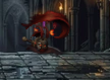

- sprite `SKELETON_KNIGHT` · lvl 12 · 250 HP · rig `public/assets/spine/monsters/skeleton-knight/title_knight_740.json`
- scale 0.045 · height 65px · faces right (flipped)
- roles: idle=`movement_ide` · attack=`movement_ide` · heavyAttack=`movement_ide` · hit=`movement_ide` · death=`movement_ide`

| animation | frames | events | used by moves |
|---|---:|---|:-:|
| `movement_ide` | 240 |  |  |

| move | intent | dmg / block | timer | choreography |
|---|---|---:|---:|---|
| Dread Lance | ATTACK | 20 | 11s | `skknight_dread_lance` |
| Phantom Trample | HEAVY_ATTACK | 33 | 15.5s | `skknight_phantom_trample` |
| Crest of Death | DEFEND | 28 | 12s | `skknight_death_crest` |
| Grave Hands | ATTACK | 17 | 12.5s | `skknight_grave_hands` |

## grave_colossus — GRAVE COLOSSUS (CORPSE TANK)

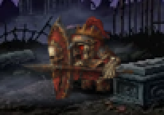

- sprite `GRAVE_COLOSSUS` · lvl 13 · 290 HP · rig `public/assets/spine/monsters/grave-colossus/zombie_CL_tank.json`
- scale 0.258 · height 65px · faces right (flipped)
- roles: idle=`idle` · attack=`atk` · heavyAttack=`atk` · hit=`idle` · death=`die`

| animation | frames | events | used by moves |
|---|---:|---|:-:|
| `atk` | 60 | atk@f28 | ✓ |
| `die` | 60 |  |  |
| `idle` | 60 |  | ✓ |
| `move` | 72 |  | ✓ |

| move | intent | dmg / block | timer | choreography |
|---|---|---:|---:|---|
| Corpse Slam | ATTACK | 22 | 12.5s | `colossus_corpse_slam` |
| Tomb Collapse | HEAVY_ATTACK | 36 | 17s | `colossus_tomb_collapse` |
| Ossuary Bulwark | DEFEND | 36 | 13.5s | `colossus_ossuary` |
| Bile Torrent | ATTACK | 17 | 12.5s | `colossus_bile` |

## void_prophet — VOID PROPHET (FORBIDDEN HERALD)

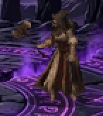

- sprite `VOID_PROPHET` · lvl 13 · 240 HP · rig `public/assets/spine/monsters/void-prophet/CultistFollower.json`
- scale 0.048 · height 64px · faces left · skin `normal`
- roles: idle=`idle` · attack=`pose_attack` · heavyAttack=`pose_cast_spell` · hit=`pose_hurt` · death=`pose_death`

| animation | frames | events | used by moves |
|---|---:|---|:-:|
| `unused/attack` | 70 | UnitActionCompleted@f28 | ✓ |
| `unused/cast` | 110 |  | ✓ |
| `unused/death` | 70 |  |  |
| `unused/hurt` | 64 |  |  |
| `idle` | 180 |  |  |
| `idle_mannerism` | 124 |  |  |
| `pose_attack` | 0 |  |  |
| `pose_cast_spell` | 0 |  |  |
| `pose_death` | 0 |  |  |
| `pose_defend` | 0 |  | ✓ |
| `pose_hurt` | 0 |  |  |
| `pose_move_back` | 70 |  |  |
| `pose_move_front` | 70 |  |  |
| `unused/walk` | 70 |  |  |

| move | intent | dmg / block | timer | choreography |
|---|---|---:|---:|---|
| Eldritch Sigil | ATTACK | 21 | 11.5s | `prophet_eldritch_sigil` |
| Cosmic Rift | HEAVY_ATTACK | 35 | 16s | `prophet_cosmic_rift` |
| Singularity Ward | DEFEND | 32 | 12.5s | `prophet_singularity` |
| Void Tendrils | ATTACK | 18 | 12.5s | `prophet_void_tendrils` |

## troll — TROLL WARLORD (REGENERATING BRUTE)

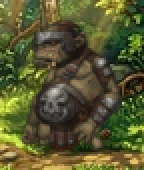

- sprite `TROLL` · lvl 13 · 300 HP · rig `public/assets/spine/monsters/troll/troll_boss.json`
- scale 0.055 · height 72px · faces right (flipped)
- roles: idle=`Idle` · attack=`Attack01` · heavyAttack=`Attack01` · hit=`Hit` · death=`Dead`

| animation | frames | events | used by moves |
|---|---:|---|:-:|
| `Attack01` | 72 |  | ✓ |
| `Dead` | 72 |  |  |
| `Hit` | 20 |  | ✓ |
| `Idle` | 80 |  | ✓ |
| `Run` | 48 |  | ✓ |

| move | intent | dmg / block | timer | choreography |
|---|---|---:|---:|---|
| Burl Club | ATTACK | 22 | 12s | `troll_burl_club` |
| Berserk Flail | HEAVY_ATTACK | 37 | 17s | `troll_berserk_flail` |
| Flesh Regrowth | DEFEND | 34 | 13s | `troll_regrowth` |
| Boulder Toss | ATTACK | 18 | 12.5s | `troll_boulder_toss` |

## bone_golem — BONE GOLEM (OSSEOUS MONSTROSITY)

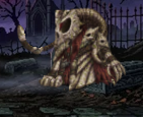

- sprite `BONE_GOLEM` · lvl 14 · 310 HP · rig `public/assets/spine/monsters/bone-golem/Boss_Swamp_golem.json`
- scale 0.058 · height 68px · faces right (flipped)
- roles: idle=`Idle` · attack=`Attack01` · heavyAttack=`Attack01` · hit=`Hit` · death=`Dead`

| animation | frames | events | used by moves |
|---|---:|---|:-:|
| `Attack01` | 54 |  | ✓ |
| `Dead` | 56 |  |  |
| `Hit` | 20 |  |  |
| `Idle` | 60 |  |  |
| `Run` | 33 |  | ✓ |

| move | intent | dmg / block | timer | choreography |
|---|---|---:|---:|---|
| Ossuary Strike | ATTACK | 23 | 12s | `bgolem_ossuary_strike` |
| Bone Spire | HEAVY_ATTACK | 38 | 16.5s | `bgolem_bone_spire` |
| Marrow Armor | DEFEND | 38 | 13s | `bgolem_marrow_armor` |
| Skull Cannon | ATTACK | 18 | 12.5s | `bgolem_skull_cannon` |

## ancient_treant — ANCIENT TREANT (ELDER OF THE GROVE)

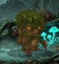

- sprite `ANCIENT_TREANT` · lvl 14 · 320 HP · rig `public/assets/spine/monsters/ancient-treant/Treant.json`
- scale 0.682 · height 70px · faces right (flipped)
- roles: idle=`Idle` · attack=`Atk` · heavyAttack=`Skill_A` · hit=`Idle` · death=`Dead`

| animation | frames | events | used by moves |
|---|---:|---|:-:|
| `Atk` | 72 | attack@f30 | ✓ |
| `Dead` | 140 |  |  |
| `Idle` | 60 |  |  |
| `Jump_Spawn` | 52 |  | ✓ |
| `Run` | 36 |  | ✓ |
| `Skill_A` | 64 | attack@f22 | ✓ |
| `zzz_AtkKodung` | 56 | attack@f32 |  |
| `zzz_Hit_Left_Kodung` | 40 |  |  |
| `zzz_Hit_LoopKOdung` | 60 |  |  |
| `zzz_Hit_Right_Kodung` | 40 |  |  |
| `zzz_Jump_Spawn_DELETE` | 50 |  |  |
| `zzz_Skill_P_DELETE` | 46 | attack@f4 |  |
| `zzz_WalkKodung` | 48 |  |  |

| move | intent | dmg / block | timer | choreography |
|---|---|---:|---:|---|
| Elder Bough | ATTACK | 23 | 12.5s | `treant_elder_bough` |
| Forest Wrath | HEAVY_ATTACK | 39 | 17.5s | `treant_forest_wrath` |
| Ironwood Bark | DEFEND | 40 | 13.5s | `treant_ironwood` |
| Acorn Meteor | HEAVY_ATTACK | 20 | 14s | `treant_seed_meteor` |

## crypt_lord — CRYPT LORD (LICH ARCHMAGE)

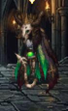

- sprite `CRYPT_LORD` · lvl 15 · 340 HP · rig `public/assets/spine/monsters/crypt-lord/Lich.json`
- scale 0.029 · height 72px · faces right (flipped)
- roles: idle=`Idle` · attack=`Attack01` · heavyAttack=`Skill01` · hit=`Hit` · death=`Dead`

| animation | frames | events | used by moves |
|---|---:|---|:-:|
| `Attack01` | 50 |  | ✓ |
| `Dead` | 80 |  |  |
| `Hit` | 20 |  |  |
| `Idle` | 160 |  |  |
| `Skill01` | 90 |  | ✓ |

| move | intent | dmg / block | timer | choreography |
|---|---|---:|---:|---|
| Lich Frostbolt | ATTACK | 24 | 11.5s | `lich_frostbolt` |
| Death Nova | HEAVY_ATTACK | 41 | 16.5s | `lich_death_nova` |
| Phylactery Guard | DEFEND | 38 | 13s | `lich_phylactery` |
| Glacial Tomb | HEAVY_ATTACK | 22 | 14s | `lich_glacial_tomb` |

## kraken — ABYSSAL KRAKEN (LEVIATHAN OF THE DEEP)

- sprite `KRAKEN` · lvl 16 · 350 HP · rig `public/assets/spine/monsters/abyssal-kraken/Octopus_Anim_01.json`
- scale 0.036 · height 75px · faces left
- roles: idle=`Idle` · attack=`Action` · heavyAttack=`Thirsty Action` · hit=`Lose` · death=`Lose2 Burn`

| animation | frames | events | used by moves |
|---|---:|---|:-:|
| `Action` | 140 |  | ✓ |
| `Idle` | 240 |  |  |
| `Lose` | 140 |  |  |
| `Lose2 Burn` | 140 |  |  |
| `Thirsty` | 140 |  | ✓ |
| `Thirsty Action` | 160 |  | ✓ |
| `Victory` | 152 |  |  |

| move | intent | dmg / block | timer | choreography |
|---|---|---:|---:|---|
| Tentacle Lash | ATTACK | 25 | 11.5s | `kraken_tentacle_lash` |
| Maelstrom Crush | HEAVY_ATTACK | 42 | 17s | `kraken_maelstrom` |
| Ink Cloud | ATTACK | 28 | 13.5s | `kraken_ink_cloud` |
| Tidal Crash | HEAVY_ATTACK | 32 | 14s | `kraken_tidal_crash` |

## demon_archbishop — ARCHBISHOP OF ASH (HIGH INQUISITOR)

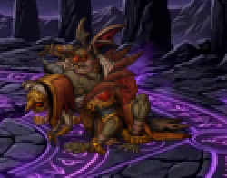

- sprite `DEMON_ARCHBISHOP` · lvl 16 · 360 HP · rig `public/assets/spine/monsters/demon-monk/Boss_Archbishop.json`
- scale 0.066 · height 75px · faces left
- roles: idle=`BOSS_Archbishop/001A_Idle` · attack=`BOSS_Archbishop/003A_Attack_A` · heavyAttack=`BOSS_Archbishop/003C_Attack_B` · hit=`BOSS_Archbishop/001A_Idle` · death=`BOSS_Archbishop/001A_Idle`

| animation | frames | events | used by moves |
|---|---:|---|:-:|
| `BOSS_Archbishop/001A_Idle` | 100 |  |  |
| `BOSS_Archbishop/002A_MoveForward` | 406 |  |  |
| `BOSS_Archbishop/003A_Attack_A` | 350 |  |  |
| `BOSS_Archbishop/003A_Attack_A_Inner` | 350 |  |  |
| `BOSS_Archbishop/003B_Attack_A2` | 364 |  |  |
| `BOSS_Archbishop/003B_Attack_A3` | 276 |  |  |
| `BOSS_Archbishop/003C_Attack_B` | 362 |  |  |
| `BOSS_Archbishop/003C_Attack_B2` | 256 |  |  |
| `BOSS_Archbishop/003C_Attack_B3` | 256 |  |  |
| `BOSS_Archbishop/003D_Attack_A3` | 380 |  |  |
| `BOSS_Archbishop/003E_Attack_ABA` | 554 |  |  |
| `BOSS_Archbishop/003F_Attack_CC` | 352 |  |  |
| `BOSS_Archbishop/003F_Attack_C_Weak` | 120 |  |  |
| `BOSS_Archbishop/003G_Attack_C` | 426 |  |  |
| `BOSS_Archbishop/003J_Attack_Spit` | 370 |  |  |
| `BOSS_Archbishop/003K_Attack_BB` | 160 |  |  |
| `BOSS_Archbishop/003L_Attack_BB_A` | 244 |  |  |
| `BOSS_Archbishop/004A_BeAttacked_Stagger_A` | 30 |  |  |
| `BOSS_Archbishop/004B_BeAttacked_Stagger_B` | 30 |  |  |
| `BOSS_Archbishop/004C_BeAttacked_StaggerHeavy_A` | 208 |  |  |
| `BOSS_Archbishop/004D_BeAttacked_StaggerHeavy_B` | 208 |  |  |
| `BOSS_Archbishop/004E_BeAttacked_Stagger_P2` | 30 |  |  |
| `BOSS_Archbishop/004F_BeAttacked_Stagger_ForBlend` | 10 |  |  |
| `BOSS_Archbishop/005A_Break` | 300 |  |  |
| `BOSS_Archbishop/005A_Break_Start` | 100 |  |  |
| `BOSS_Archbishop/005B_Break_Loop` | 80 |  |  |
| `BOSS_Archbishop/005C_Break_End` | 90 |  |  |
| `BOSS_Archbishop/005D_Break_Attack_A` | 66 |  |  |
| `BOSS_Archbishop/005E_Break_Attack_B` | 66 |  |  |
| `BOSS_Archbishop/006A_Tired` | 140 |  |  |
| `BOSS_Archbishop/006B_Defense` | 64 |  |  |
| `BOSS_Archbishop/006C_PerformanceA` | 440 |  |  |
| `BOSS_Archbishop/006D_PerformanceB` | 298 |  |  |
| `BOSS_Archbishop/006E_PerformanceC` | 64 |  |  |
| `BOSS_Archbishop/007A_Die` | 200 |  |  |
| `BOSS_Archbishop/007A_Die4` | 298 |  |  |
| `BOSS_Archbishop/0010A_Born` | 406 |  |  |
| `zBackup/001B_Idle_P2` | 100 |  |  |
| `zBackup/001C_Idle_ToP1` | 72 |  |  |

| move | intent | dmg / block | timer | choreography |
|---|---|---:|---:|---|
| Ash Liturgy | ATTACK | 26 | 12s | `bishop_ash_liturgy` |
| Profane Pillar | HEAVY_ATTACK | 44 | 17s | `bishop_profane_pillar` |
| Inquisitor Aegis | DEFEND | 42 | 13.5s | `bishop_aegis` |
| Brimstone Censer | ATTACK | 21 | 12.5s | `bishop_brimstone_censer` |

## inferno_titan — INFERNO TITAN (COLOSSUS OF FLAME)

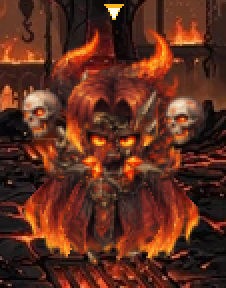

- sprite `INFERNO_TITAN` · lvl 17 · 380 HP · rig `public/assets/spine/monsters/inferno-titan/Demogorgon.json`
- scale 0.143 · height 75px · faces right (flipped)
- roles: idle=`1_Ready` · attack=`3_Kill` · heavyAttack=`4_Summon` · hit=`1_Ready` · death=`1_Ready`

| animation | frames | events | used by moves |
|---|---:|---|:-:|
| `1_LobbyRun` | 120 |  |  |
| `1_Ready` | 120 |  |  |
| `2_1Walk` | 240 |  |  |
| `2_2Run` | 240 |  | ✓ |
| `2_2Run_Ready` | 120 |  |  |
| `3_Kill` | 120 |  | ✓ |
| `4_Summon` | 150 |  | ✓ |

| move | intent | dmg / block | timer | choreography |
|---|---|---:|---:|---|
| Magma Hammer | ATTACK | 27 | 12s | `titan_magma_hammer` |
| Apocalypse Flare | HEAVY_ATTACK | 46 | 17.5s | `titan_apocalypse` |
| Igneous Plate | DEFEND | 45 | 14s | `titan_igneous` |
| Skull Pyre | ATTACK | 21 | 12.5s | `titan_skull_pyre` |

## dark_emperor — DARK EMPEROR (SOVEREIGN OF RUIN)

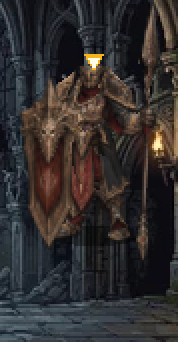

- sprite `DARK_EMPEROR` · lvl 18 · 400 HP · rig `public/assets/spine/monsters/dark-emperor/DeathKnight.json`
- scale 0.045 · height 75px · faces left · skin `normal`
- roles: idle=`idle` · attack=`pose_attack` · heavyAttack=`pose_cast_spell` · hit=`pose_hurt` · death=`pose_death`

| animation | frames | events | used by moves |
|---|---:|---|:-:|
| `idle` | 140 |  |  |
| `idle_mannerism` | 140 |  |  |
| `pose_attack` | 0 |  | ✓ |
| `pose_cast_spell` | 0 |  | ✓ |
| `pose_death` | 0 |  |  |
| `pose_defend` | 0 |  | ✓ |
| `pose_hurt` | 0 |  |  |
| `pose_move_back` | 0 |  | ✓ |
| `pose_move_front` | 0 |  | ✓ |
| `pose_ranged_attack_v1` | 0 |  |  |
| `pose_ranged_attack_v2` | 0 |  |  |
| `pose_ranged_attack_v3` | 0 |  |  |

| move | intent | dmg / block | timer | choreography |
|---|---|---:|---:|---|
| Imperial Slash | ATTACK | 28 | 12s | `emperor_imperial_slash` |
| Sovereign Ruin | HEAVY_ATTACK | 48 | 17.5s | `emperor_sovereign_ruin` |
| Crown of Shadows | DEFEND | 45 | 13.5s | `emperor_crown_shadows` |
| Legion of Ruin | HEAVY_ATTACK | 25 | 14s | `emperor_shadow_legion` |

## magma_dragon — MAGMA DRAGON (SCORCHED WYRM)

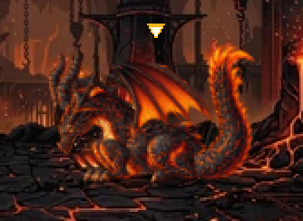

- sprite `MAGMA_DRAGON` · lvl 19 · 420 HP · rig `public/assets/spine/monsters/magma-dragon/Mission_104_dragon.json`
- scale 0.212 · height 75px · faces right (flipped)
- roles: idle=`idle1` · attack=`attack` · heavyAttack=`attack` · hit=`idle1` · death=`idle1`

| animation | frames | events | used by moves |
|---|---:|---|:-:|
| `attack` | 120 |  | ✓ |
| `idle1` | 160 |  |  |
| `idle2` | 80 |  | ✓ |
| `open` | 80 |  | ✓ |

| move | intent | dmg / block | timer | choreography |
|---|---|---:|---:|---|
| Tail Whip Flame | ATTACK | 30 | 12s | `dragon_tail_whip` |
| Inferno Breath | HEAVY_ATTACK | 52 | 18s | `dragon_inferno_breath` |
| Dragon Scales | DEFEND | 48 | 14s | `dragon_scales` |
| Meteor Wings | HEAVY_ATTACK | 26 | 14s | `dragon_meteor_storm` |

## eldritch_horror — ELDRITCH HORROR (CTHULHU INCARNATE)

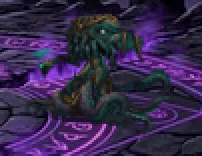

- sprite `ELDRITCH_HORROR` · lvl 20 · 450 HP · rig `public/assets/spine/monsters/eldritch-horror/BS_Cthulhu.json`
- scale 0.024 · height 80px · faces left
- roles: idle=`idle` · attack=`attack` · heavyAttack=`bigat` · hit=`1Hit` · death=`1Hit`

| animation | frames | events | used by moves |
|---|---:|---|:-:|
| `1Hit` | 0 |  |  |
| `attack` | 60 | gongji@f18 | ✓ |
| `bigat` | 120 | gongji@f96 | ✓ |
| `idle` | 120 |  |  |
| `move` | 60 |  | ✓ |

| move | intent | dmg / block | timer | choreography |
|---|---|---:|---:|---|
| Tentacle Grasp | ATTACK | 32 | 12.5s | `horror_tentacle_grasp` |
| Cosmic Madness | HEAVY_ATTACK | 55 | 18.5s | `horror_cosmic_madness` |
| Void Distortion | DEFEND | 50 | 14s | `horror_void_distortion` |
| Abyssal Gaze | HEAVY_ATTACK | 27 | 14s | `horror_abyssal_gaze` |
